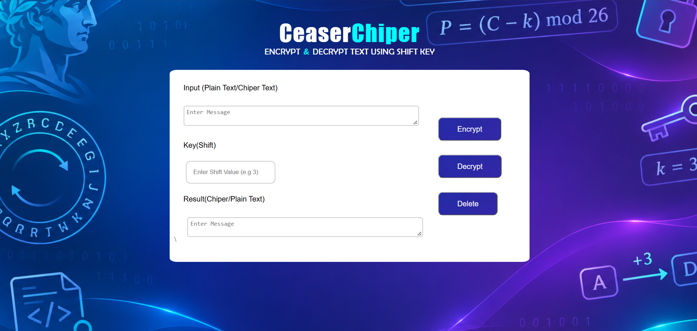

#**CAESAR CHIPER WEB APPLICATION**

##The Caesr chiper appllication is a simple web based application desing to Encrypt & Decrypt text using secret key
using simple caesar chiper algoritham

**Feature**
   - Encrypt Text using secret key
   - Decrypt Text using secret key
   - Simple , Userf riendly Interface
   - Simple Approach

**Technology**
   - Html : Structer of Application
   - CSS : Style fo user Interface
   - Java Script : Logic that use Encrypt & Decrypt

**How to Use**
   - Enter the Input (Encrypt/Decrypt)
   - Enter the Button (Encrypt/Decrypt)
   - Viwe the Result

**Limitation**
 - Application can use only Capital letters not allowed Symboles, simple letters and others.

**Previwe**
## Project Screenshot

